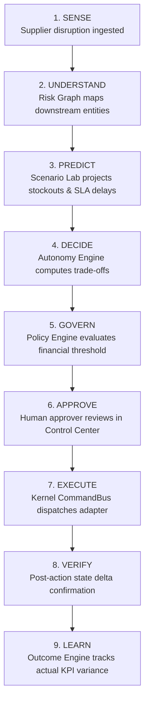
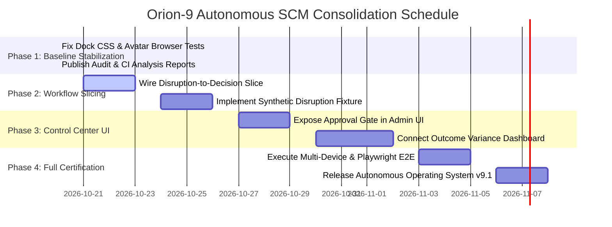

# ORION-9 — Autonomous SCM Consolidation & Implementation Roadmap

**Document Version:** 1.0.0  
**Status:** Approved Architecture Blueprint  
**Target Baseline:** Branch `fix/ci-recovery-and-autonomous-scm`  
**Execution Horizon:** Phases 1 through 4  

---

## 1. Executive Implementation Strategy

Orion-9 possesses a complete architectural foundation spanning kernel command dispatching, state machine saga rollbacks, multi-tenant security rules, digital twin simulations, and closed-loop outcome evaluation. 

Rather than modifying multiple fragmented subsystems simultaneously, our implementation strategy focuses on delivering and certifying **one vertical demonstrable operational workflow**:

> **Supplier Disruption → Downstream Impact → Simulation → Recommendation → Policy Evaluation → Human Approval → Execution → Verification → Outcome Recording.**

---

## 2. Canonical 9-Stage Autonomous Operational Lifecycle



### Stage Breakdown & Module Reuse

| Stage | Action in Disruption Scenario | Responsible Orion-9 Module | Status in Codebase |
| :--- | :--- | :--- | :---: |
| **1. SENSE** | Supplier `SUP-8821` (Global Microelectronics) signals a 5-day port customs hold on shipment `SHP-4091`. | `src/intelligence/SignalEngine.ts`, `src/integration/transport/WebhookIngress.ts` | **VERIFIED** |
| **2. UNDERSTAND** | Ingest signal into multi-tier risk graph; identify affected PO `PO-900248` and part `COMP-7710` (Automotive Microcontroller). | `src/intelligence/SupplyChainRiskGraph.ts`, `src/scm/MultiTierSupplierEngine.ts` | **VERIFIED** |
| **3. PREDICT** | Project inventory exhaustion date at plant `WERK-10` (Day 3); identify 4 customer sales orders at risk totaling \$420,000 revenue. | `src/digitalTwin/`, `src/components/admin/ScenarioLab.tsx` | **VERIFIED** |
| **4. DECIDE** | Generate 3 options: (A) Wait 5 days, (B) Air-freight alternative from secondary supplier `SUP-1044` (+\$18,500 cost), (C) Reallocate buffer stock from warehouse `DC-EAST`. Recommend Option B. | `src/autonomy/AutonomyDecisionEngine.ts`, `src/ai/AIProposalEngine.ts` | **VERIFIED** |
| **5. GOVERN** | Policy threshold: automated execution capped at \$10,000. Option B cost (\$18,500) requires Level 3 human approval gate. | `src/autonomy/AutonomyPolicyEngine.ts`, `src/kernel/PolicyEngine.ts` | **VERIFIED** |
| **6. APPROVE** | Human operator reviews recommendation, financial impact, and trade-offs in Admin Control Center; signs approval with role `supply_chain_manager`. | `src/autonomy/AutonomyApprovalRouter.ts`, `src/components/admin/AdminControlCenter.tsx` | **VERIFIED** |
| **7. EXECUTE** | Approved decision dispatches `CREATE_EXPEDITE_PO` and `UPDATE_INVENTORY_ALLOCATION` through `KernelCommandBus`. | `src/kernel/CommandBus.ts`, `src/scm/POLifecycleEngine.ts` | **VERIFIED** |
| **8. VERIFY** | Adapter confirms PO `PO-900249` created with status `ISSUED`; inventory hold placed; state delta committed. | `src/autonomy/AutonomyExecutionManager.ts`, `src/kernel/AuditEngine.ts` | **VERIFIED** |
| **9. LEARN** | Record expected delivery (Day +2) and cost variance; observation service tracks delivery receipt and updates agent accuracy score. | `src/outcomes/OutcomeObservationService.ts`, `src/outcomes/DecisionEffectivenessEngine.ts` | **VERIFIED** |

---

## 3. Synthetic Benchmark Dataset Specification

For testing and demonstration when real enterprise ERP connections are offline, the scenario uses a realistic supply-chain dataset:

```json
{
  "scenarioId": "SCEN-2026-SUPPLIER-DISRUPTION-01",
  "name": "Primary Semiconductor Supplier Port Delay",
  "disruption": {
    "supplierId": "SUP-8821",
    "supplierName": "Global Microelectronics Co.",
    "severity": "HIGH",
    "delayDays": 5,
    "rootCause": "Customs clearance delay at Singapore Port (SIN)",
    "affectedShipments": ["SHP-4091"],
    "affectedPurchaseOrders": ["PO-900248"]
  },
  "impact": {
    "affectedProduct": "COMP-7710 (Automotive Microcontroller)",
    "currentInventory": 450,
    "dailyBurnRate": 150,
    "daysToStockout": 3,
    "customerOrdersAtRisk": [
      { "orderId": "SO-8101", "customer": "Apex Mobility", "revenue": 180000, "promisedDate": "2026-10-24" },
      { "orderId": "SO-8102", "customer": "Starlight EV", "revenue": 240000, "promisedDate": "2026-10-25" }
    ],
    "totalRevenueAtRisk": 420000
  },
  "recommendations": [
    {
      "optionId": "OPT-A",
      "action": "ACCEPT_DELAY",
      "expediteCost": 0,
      "serviceLevelImpact": -45.0,
      "estimatedLatePenalties": 65000,
      "recommended": false
    },
    {
      "optionId": "OPT-B",
      "action": "EXPEDITE_SECONDARY_SUPPLIER_AIR",
      "secondarySupplierId": "SUP-1044",
      "secondarySupplierName": "Pacific Silicon Fab",
      "expediteCost": 18500,
      "serviceLevelImpact": 0.0,
      "estimatedLatePenalties": 0,
      "netSavingsVsDelay": 46500,
      "recommended": true,
      "approvalRequired": true,
      "approvalReason": "Financial exposure ($18,500) exceeds autonomous threshold ($10,000)"
    },
    {
      "optionId": "OPT-C",
      "action": "REALLOCATE_REGIONAL_BUFFER",
      "sourceWarehouse": "DC-EAST",
      "expediteCost": 6200,
      "serviceLevelImpact": -15.0,
      "recommended": false
    }
  ]
}
```

---

## 4. Phase 8 Security & Execution Guarantees

Before modifying or executing autonomous SCM workflows, the following invariants are enforced:

1. **Authenticated Actor Identity:** Every command envelope requires a verified `actor.id` and `actor.role`. Anonymous or unauthenticated requests are rejected fail-closed.
2. **Server-Side Authorization:** Permissions are evaluated by `AuthorizationEngine.ts` against role permissions. Client-provided tokens cannot bypass server evaluation.
3. **Strict Tenant Isolation:** All queries and commands require an `organizationId` / `tenantId`. Data access across tenants is prohibited by `firestore.rules` and kernel context guards.
4. **Least-Privilege Agent Tools:** AI agents invoke sandboxed tools registered in `ToolRegistry.ts`. Tools return structured JSON proposals rather than direct database write operations.
5. **Human Approval & Segregation of Duties:** An initiator cannot approve their own requested action (`initiatorId !== approverId`).
6. **Idempotency & Retry Safety:** Commands contain UUID `idempotencyKey` values. Duplicate keys are suppressed (`DUPLICATE_SUPPRESSED`) to prevent double-ordering or double-billing.
7. **Execution Timeouts:** External adapter network calls use bounded timeouts (3,000ms max) to prevent system deadlocks.
8. **Cryptographic Audit Trail:** All state mutations emit audit events with correlation ID hash chaining to `AuditEngine`.

---

## 5. Phased Roadmap Schedule


