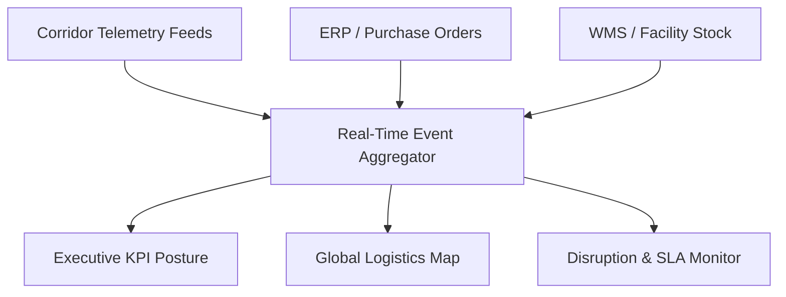

# Supply Chain Control Tower & Command Center

## Purpose & Scope
The Supply Chain Control Tower (`src/components/Dashboard.tsx`) is the core operational cockpit of Orion-9. It unifies multimodal visibility across road, rail, maritime, and air freight corridors with real-time exception detection.

## Key UI Sections
1. **Executive Posture Bar**: Global On-Time In-Full (OTIF), SLA Integrity, Carbon Footprint, and Active Capital Exposure.
2. **Interactive Logistics Map**: Real-time asset positioning, active weather overlays, geofenced port choke points.
3. **Disruption Radar**: Live alerts categorized by severity (`CRITICAL`, `HIGH`, `MEDIUM`, `LOW`).
4. **Autonomous Resolution Action**: One-click bypass corridor simulation when disruptions occur.
