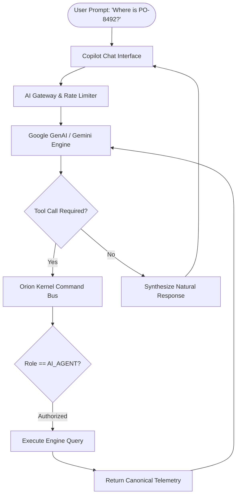

# Orion AI Copilot Architecture

## System Design
The Orion Copilot (`src/components/AICopilot.tsx`) provides natural language supply-chain assistance. It connects to Google Gemini via `@google/genai` or deterministic local fallback models.

## Governed Tool Capabilities
- `query_inventory_level(sku, facilityId)`: Read-only stock lookup.
- `track_shipment(shipmentId)`: Current GPS, corridor status, ETA.
- `simulate_disruption(corridorId, delayHours)`: Scenario evaluation.
- `draft_purchase_order(supplierId, items)`: Proposals require **Human Approval** before execution.

## Security & Data Privacy
- **Zero Hallucination Policy**: Operational metrics (inventory counts, dollar amounts, ETAs) are queried directly from authoritative engines.
- **Fail-Closed Permissions**: The Copilot cannot view data or invoke actions outside the logged-in user's tenant boundary.
