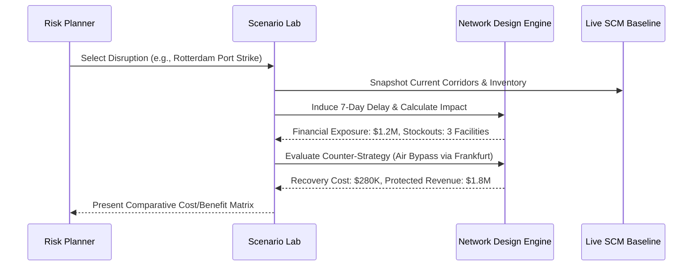

# Scenario Lab & Disruption Simulation

## Purpose & Scope
The Scenario Lab (`src/components/Scenarios.tsx` and `src/components/admin/ScenarioLab.tsx`) allows risk managers to evaluate "what-if" disruptions without modifying live production operational data.

## Supported Disruption Models
- **Maritime Bottleneck**: Port closure or canal blockage with route transit delays.
- **Supplier Default**: Tier-1 or Tier-2 supplier insolvency triggering secondary sourcing.
- **Demand Surge**: Unanticipated 300%+ order spikes challenging regional fulfillment limits.
