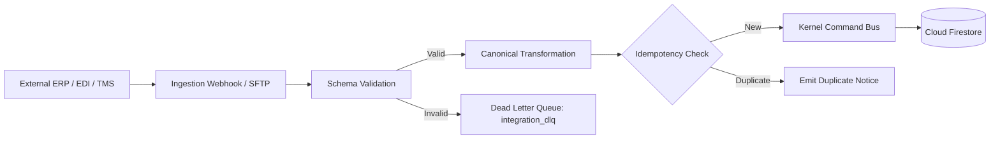

# Integration Fabric & Canonical Pipeline

## Canonical Entities
The `ScmCanonicalRegistry` transforms external proprietary schemas (SAP IDocs, Oracle REST payloads, EDIFACT messages) into standardized internal TypeScript interfaces, isolating core business engines from external system idiosyncrasies.
