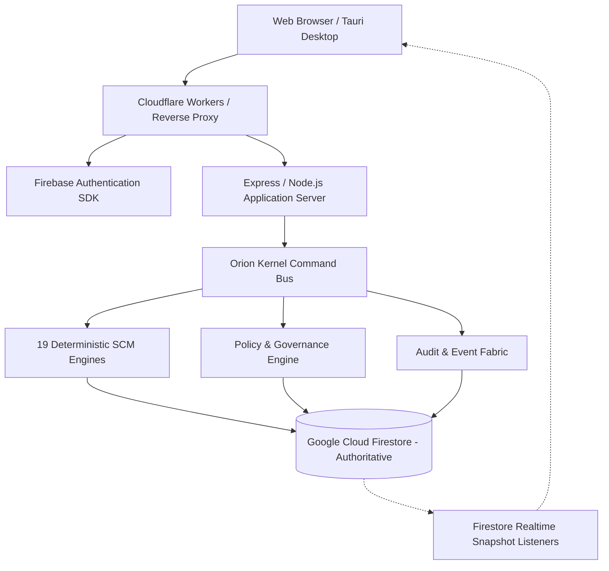

# End-to-End System Architecture

Orion-9 is architected around an event-driven, micro-kernel architecture designed for zero client authority, deterministic business calculations, and strict tenant isolation.

## Architectural Pillars
1. **Zero Client Authority**: Clients submit intents as commands; only the server-side kernel commits state changes.
2. **Deterministic Calculations**: No probabilistic or LLM-generated business numbers.
3. **Multi-Tenant Isolation**: Every collection query is filtered by `tenantId`.
4. **Offline Resilience**: Local-first IndexedDB buffer preserves operational continuity during network outages.
