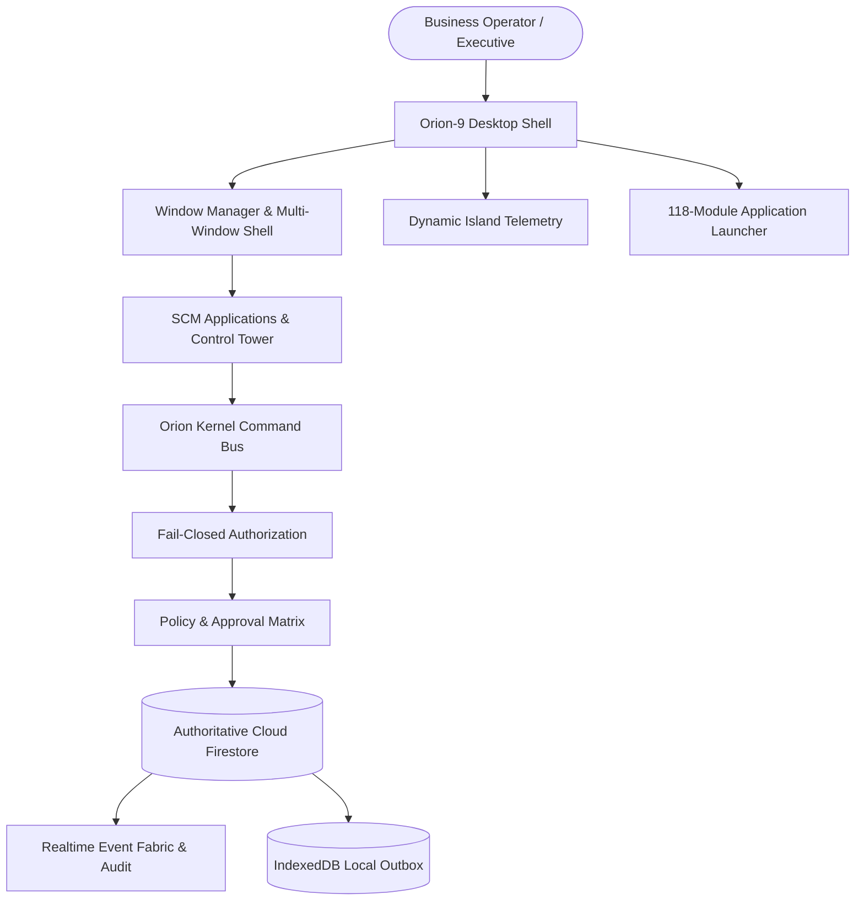

# Orion-9 Operating System Overview

## What is Orion-9?
Orion-9 is a desktop-grade Supply Chain Operating System (OS). It combines a high-performance multi-window web and native desktop environment with 19 deterministic supply chain management engines, real-time Cloud Firestore synchronization, fail-closed authorization, and governed AI Copilot orchestration.

## Core Operating Principles
1. **Operating System Paradigm**: Applications run inside draggable, resizable, minimizable windows with complete desktop isolation, keyboard shortcuts, and responsive layouts.
2. **Zero Client Authority**: Web and desktop clients cannot mutate state directly; all actions pass through the authoritative `KernelCommandBus` with tenant isolation.
3. **Deterministic Business Logic**: Supply chain formulas (ATP, Working Capital, 3-Way Invoicing Match, Economic Order Quantity) are strictly calculated by verified TypeScript engines.
4. **Governed AI Integration**: AI operates under an explicit `AI_AGENT` role. High-consequence mutations require explicit human approval before execution.

---
*Source Implementation: `src/os/OrionDesktop.tsx`, `src/kernel/KernelCommandBus.ts`*
