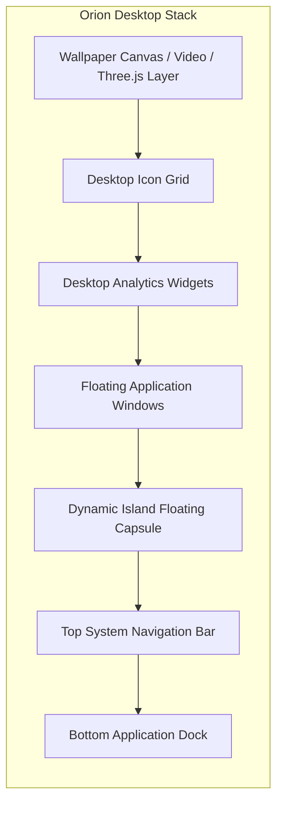

# Orion-9 Desktop & Workspace Environment

## Architectural Overview
The Orion-9 Desktop is rendered by `src/os/components/OrionDesktop.tsx`. It provides an operating-system workspace with window layer hierarchies, customizable desktop wallpapers, a widget system, and contextual entity menus.

## Desktop Features
- **Icon Grid Management**: Drag, reposition, align to grid, and double-click to launch.
- **Right-Click Context Menu**:
  - *New Window*: Launches any registered app directly.
  - *Clean Up Icons*: Re-aligns scattered icons into geometric rows.
  - *Change Wallpaper*: Opens the Wallpaper Gallery modal.
  - *Display Settings*: Directly opens display scale and typography preferences.
- **Live Wallpaper Engine**:
  - High-resolution dark enterprise photography.
  - Interactive WebGL kinetic particle flows.
  - Low-power mode for laptops (disables dynamic shaders when battery-operated).

---
*Implementation: `src/os/components/OrionDesktop.tsx`, `src/os/wallpaper/WallpaperRuntime.tsx`*
