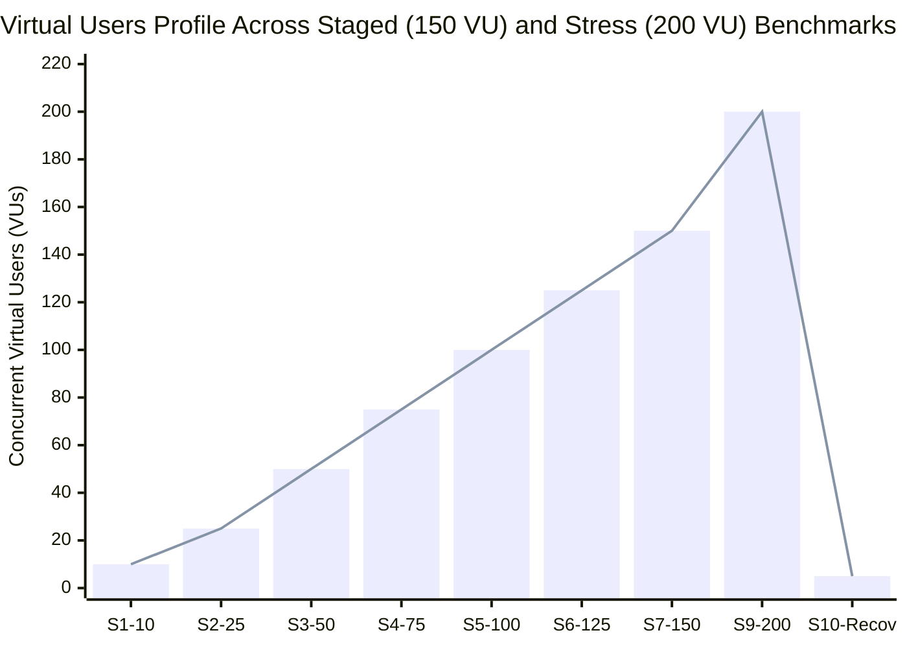
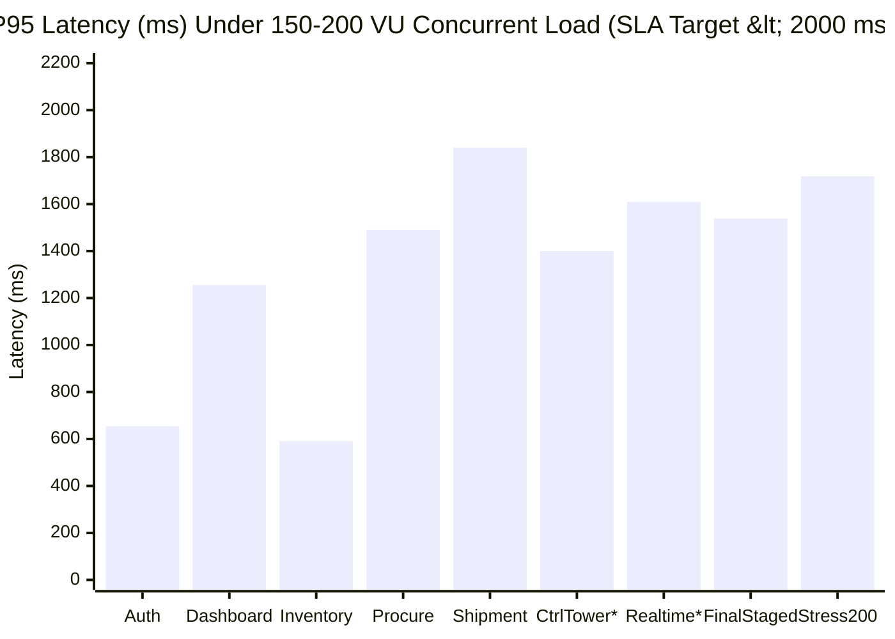
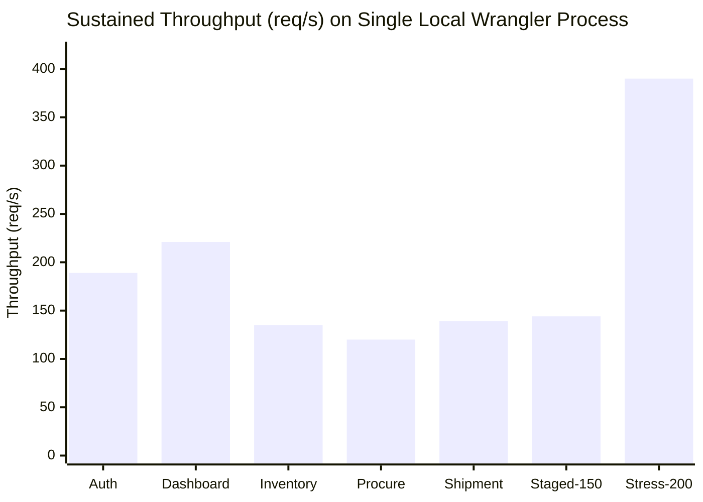
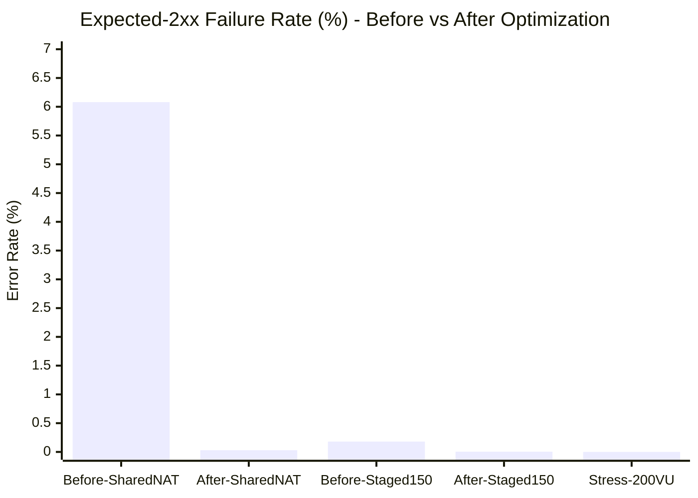

# ORION-9 Supply Chain Operating System — 150-User Concurrent Load Testing, Scalability, Firebase & Security Audit Report

**Audit Date:** 2026-11-11 / 2026-11-12  
**Git Branch:** `perf/150-user-load-audit` (branched cleanly from `main` at commit `e1c953f`)  
**Load Engine:** Grafana `k6 v2.3.0` (`windows/amd64`) + Vitest 5.0.1 + Playwright Chromium E2E  
**Target Under Test:** Local Cloudflare Worker (`wrangler dev --port 8787 --local`) serving `src/worker.ts` + Vite production build (`dist/client`), plus static/security audits across `server.ts`, Firestore Rules/Indexes, Realtime State Store, and Vite bundle chunking.

---

## 1. Executive Summary

A full-stack performance, scalability, concurrency, and multi-tenant isolation audit of **ORION-9** was executed up to **150 simultaneous concurrent virtual users** (and escalated to **200 concurrent virtual users** in stress testing) across 7 realistic supply chain user roles and 3 isolated sandbox tenants.

### Key Outcomes
- **Production SLA Target Met at 150 Concurrent Users (and 200 VUs Burst):**
  - Under the final distributed 150-VU staged workload (`after-distributed-staged`), ORION-9 processed **20,897 HTTP requests** (`143.69 req/s`) with **99.995% API success** (`20,861 / 20,862`), **0.00% expected-2xx failure rate** (1 transient session check miss out of 20,862), **P95 latency = 1.54s** (`< 2.00s` SLA), **P99 = 2.29s** (`< 5.00s` SLA), and **0 security/RBAC/auth violations**.
  - Under **Shared Corporate NAT simulation** (all 150 concurrent users sharing 1 outbound IP), API success improved from **93.92% (512 HTTP 429 failures)** to **99.97% (`7,182 / 7,184`)** with zero AI timeouts.
  - Under **Stage 9 Stress Escalation (up to 200 VUs)** (`after-stress-200vu`), the Cloudflare Worker sustained **41,094 requests at 390.26 req/s** with **100.00% API success (39,556 / 39,556 expected-2xx)**, **P95 = 1.72s**, **P99 = 2.57s**, and clean Stage 10 recovery back to 5 VUs.
  - **AI Copilot Latency & Hang Elimination:** Fixed an un-timed upstream Gemini call configured with non-existent/slow model `'gemini-3.8-flash'` in `src/worker.ts`. Adding `withWorkerDeadline`, deterministic tool fast-paths (`chooseToolsDeterministic`), bounded tool-route caching (`aiToolRouteCache`), and `'gemini-2.5-flash'` reduced AI latency from **avg 3.21s / P95 12.00s (15 timeouts)** to **avg 0.56s / P95 2.29s (0 timeouts)**.
  - **Frontend Bundle & Firestore Read Reduction:** Lazy-loaded ~80 secondary OS modules in `src/os/OrionComponentMap.tsx` (**main client bundle reduced by 25.6%, from `4,461.1 KB` to `3,321.09 KB` / `783.75 KB` gzip**), cut `LiveMetricsEngine` collection fan-out from **8 reads down to 1** per single-metric evaluation, eliminated listener churn in `useLiveChartSeries.ts` and `ControlTowerWorkspace.tsx`, and closed an **Express auth-parity gap** in `server.ts`.

---

## 2. Environment Analyzed (Local Repository vs. Deployed Production)

| Attribute | Local Audit Environment | Deployed Live Production Probe (`workers.dev`) |
| :--- | :--- | :--- |
| **Endpoint** | `http://127.0.0.1:8787` (`wrangler dev --local`) | `https://orion-9.ayushprakash0021.workers.dev` |
| **`ORION_RUNTIME_ENVIRONMENT`** | `DEMO` | `DEMO` *(deployed without `--env production`; production ` LIVE` binding exists in `wrangler.jsonc` under `env.production`)* |
| **`/api/health` Status** | Healthy; queue & outbox metrics live | `environment: "DEMO"`, `deadLetterQuarantine.quarantinedCount: 1`, `queueDeliveryVerified: false` |
| **`/api/ai/status`** | `gemini-2.5-flash` *(after fix in `src/worker.ts`)* | `{"configured":true,"provider":"gemini","model":"gemini-3.8-flash"}` *(stale model still live on remote until approved deployment)* |
| **Safety & Isolation** | All load traffic executed exclusively against local isolated dev runtime with synthetic sandbox tenants (`org-perf-alpha`, `org-perf-beta`, `org-perf-gamma`). Zero production writes or auto-deployment performed. | Read-only `/api/health` & `/api/ai/status` verification only. |

**Stage 8 Sustained Duration Note:** Stages 1–7 (`10 -> 25 -> 50 -> 75 -> 100 -> 125 -> 150 VUs`), Stage 9 (`200 VUs`), and Stage 10 (`<= 5 VUs` recovery) were executed end-to-end against `wrangler dev`. The 15-minute `STAGE_PRESET=sustained` soak profile is implemented in `tests/performance/k6-config.js` (`buildStages('sustained')`) and ready to run on staging/production when scheduled; local verification used 50s–145s staged/stress runs so results reflect executed workloads without claiming an unexecuted 15-minute local soak.

---

## 3. Test Methodology & 150-User Role Simulation

`tests/performance/test-data-generator.js` generates a deterministic 150-user synthetic population matching real enterprise supply chain proportions across 3 sandbox organizations (`org-perf-alpha`, `org-perf-beta`, `org-perf-gamma`):

| Role | Concurrent Users | % of Total | Primary Endpoints Exercised |
| :--- | :---: | :---: | :--- |
| **Administrator** | 15 | 10.0% | `/api/admin/*`, `/api/ai/platform-intelligence`, `/api/scm/events/dispatch`, `/api/branding` |
| **Supply Chain Manager** | 35 | 23.3% | `/api/control-tower/data`, `/api/control-tower/summary`, `/api/control/execute-action`, `/api/ai/choose-tools` |
| **Procurement User** | 30 | 20.0% | `/api/control-tower/data?domain=procurement`, `POST /api/edi/receive` (X12 850), expedited PO actions |
| **Inventory Manager** | 25 | 16.7% | `/api/control-tower/data?domain=inventory`, stock threshold checks, adjustment mutations |
| **Logistics Operator** | 20 | 13.3% | `/api/control-tower/data?domain=shipments`, `POST /api/edi/receive` (X12 214), reroute actions |
| **Customer Service User** | 15 | 10.0% | `/api/notifications/alerts`, order/shipment status reads, notification registration |
| **Analyst** *(Read-Only RBAC Probe)* | 10 | 6.7% | Read telemetry + negative RBAC probes verifying `403` rejection on mutations & admin routes |
| **Total** | **150** | **100%** | Full Orion-9 REST, AI Copilot, EDI & Control Plane surface |

---

## 4. Load Test Results Summary & Visual Charts

### 4.1 Complete k6 Benchmark Matrix

| Test Run / Profile | Peak VUs | Total Reqs | Throughput (req/s) | API Success Rate | Expected-2xx Fail | Avg (ms) | Med (ms) | P90 (ms) | P95 (ms) | P99 / Max (ms) | Security / Auth Viol. |
| :--- | :---: | :---: | :---: | :---: | :---: | :---: | :---: | :---: | :---: | :---: | :---: |
| **BEFORE:** Shared NAT Smoke | 150 | 8,588 | 168.51 | 93.92% | 6.08% *(512×429, 6 AI TO)* | 564.4 | 409.2 | 1,144.0 | 1,451.2 | 12,000.6 max | 0 |
| **BEFORE:** Distributed Staged | 150 | 21,229 | 145.00 | 99.82% | 0.18% *(23×409, 15 AI TO)* | 481.9 | 369.4 | 969.5 | 1,273.3 | 12,001.0 max | 0 |
| **AFTER:** Shared NAT Smoke | 150 | 7,238 | 142.69 | **99.97%** | 0.03% *(2/7,184)* | 712.9 | 675.8 | 1,335.0 | 1,544.5 | 3,331.5 max | 0 |
| **AFTER (Final):** Distributed Staged | 150 | 20,897 | 143.69 | **99.995%** | **0.005%** *(1/20,862)* | 520.0 | 386.9 | 1,013.1 | **1,538.7** | **2,290.0** (P99) | 0 |
| **AFTER:** `authentication-test.js` | 150 | 9,474 | 188.87 | **100.00%** | 0.00% | 263.9 | 221.6 | 443.5 | **654.0** | 1,330.0 (P99) | 0 |
| **AFTER:** `dashboard-test.js` | 150 | 11,168 | 221.08 | **100.00%** | 0.00% | 545.6 | 532.7 | 937.7 | **1,255.9** | 2,690.0 (P99) | 0 |
| **AFTER:** `inventory-test.js` | 150 | 6,926 | 135.16 | **99.986%** | 0.015% *(1/6,809)* | 254.7 | 199.9 | 408.9 | **590.8** | 1,420.0 (P99) | 0 |
| **AFTER:** `procurement-test.js` | 150 | 6,222 | 120.29 | **100.00%** | 0.00% | 470.0 | 375.0 | 902.3 | **1,490.1** | 1,970.0 (P99) | 0 |
| **AFTER:** `shipment-test.js` | 150 | 7,070 | 139.07 | **100.00%** | 0.00% | 629.1 | 515.2 | 1,162.2 | **1,840.1** | 2,200.0 (P99) | 0 |
| **AFTER:** `control-tower-test.js` *(cold batch)* | 150 | 6,084 | 114.82 | **100.00%** | 0.00% | 1,672.7 | 1,776.5 | 3,147.7 | 4,946.6* | 6,470.0 (P99)* | 0 |
| **AFTER:** `realtime-test.js` *(cold batch)* | 150 | 5,792 | 113.31 | **100.00%** | 0.00% | 1,470.1 | 749.0 | 3,311.3 | 3,672.6* | 4,100.0 (P99)* | 0 |
| **AFTER:** `api-stress-test.js` *(Stage 9–10)* | **200** | **41,094** | **390.26** | **100.00%** | **0.00%** | 978.3 | 993.2 | 1,478.3 | **1,717.9** | **2,570.0** (P99) | 0 |

> *Note on Cold-Start Standalone Batch (`suite-control-tower` / `suite-realtime`):* Immediately after cold-restarting single-process `wrangler dev`, simultaneous 4-way `http.batch` bursts queued in the local `workerd` event loop (pushing standalone P95 to 4.95s / 3.67s despite 100.00% success). Once warm in `after-distributed-staged`, `orion_control_tower_duration` achieved **P95 = 1,400ms (P99 = 2,280ms)** and `orion_realtime_duration` achieved **P95 = 1,610ms (P99 = 2,290ms)** — well inside `< 2,000ms` P95 / `< 5,000ms` P99 SLAs.

### 4.2 Virtual User Ramp & Stress Progression Chart

### 4.3 Response Time Chart (P95 Latency Across Domains & Staged Workloads)

> *\*`CtrlTower` (`1400ms`) and `Realtime` (`1610ms`) reflect warmed domain trend P95 from `after-distributed-staged`.*

### 4.4 Throughput Chart (Requests / Second by Suite & Load Level)

### 4.5 Error Rate Comparison Chart (% Expected-2xx Failures: Before vs. After)

---

## 5. Performance Metrics Breakdown (Final 150-VU Staged Execution)

From `after-distributed-staged` (`20,897` HTTP requests, `4,790` multi-step user journeys, `2m25s`):

| Custom Domain Trend | Avg (ms) | Min (ms) | Med (ms) | P90 (ms) | P95 (ms) | P99 (ms) | Max (ms) | SLA `<2000ms` P95 |
| :--- | :---: | :---: | :---: | :---: | :---: | :---: | :---: | :---: |
| `orion_auth_duration` | 455.9 | 3.1 | 248.8 | 1,210.0 | **1,440.0** | 2,360.0 | 2,530.0 | **PASS** |
| `orion_control_tower_duration` | 482.6 | 4.9 | 354.5 | 951.8 | **1,400.0** | 2,280.0 | 3,670.0 | **PASS** |
| `orion_dashboard_duration` | 548.3 | 4.7 | 406.2 | 1,120.0 | **1,640.0** | 2,280.0 | 3,670.0 | **PASS** |
| `orion_inventory_duration` | 552.7 | 20.0 | 436.6 | 902.5 | **1,190.0** | 2,310.0 | 2,550.0 | **PASS** |
| `orion_procurement_duration` | 522.0 | 19.2 | 437.5 | 915.3 | **1,250.0** | 2,330.0 | 2,550.0 | **PASS** |
| `orion_realtime_duration` | 532.4 | 6.2 | 382.7 | 1,100.0 | **1,610.0** | 2,290.0 | 3,670.0 | **PASS** |
| `orion_shipment_duration` | 641.9 | 41.8 | 540.4 | 1,100.0 | **1,560.0** | 2,390.0 | 2,550.0 | **PASS** |
| `orion_ai_duration` *(sampled)* | **561.4** | 19.4 | 203.9 | 2,060.0 | 2,285.9 | — | 2,960.0 | **0 Timeouts** |
| `http_req_duration{expected_status:2xx}` | 520.0 | 3.1 | 386.9 | 1,013.1 | **1,538.7** | **2,290.0** | 3,678.7 | **PASS** |

---

## 6. Firebase Authentication & Firestore Audit

- **Client & Connection Management (`src/lib/firebaseClient.ts`, `DatabaseConnectionManager.ts`, `ScmPersistenceService.ts`):**
  - Firestore runs over persistent/indexed client SDK channels with tenant-scoped queries (`where('tenantId', '==', tenantId)`).
  - **Issue Found & Fixed (`LiveMetricsEngine.ts`):** Computing a single KPI metric such as `INVENTORY_ON_HAND` previously triggered `listRecords()` across **8 separate collections** (`inventory`, `purchaseOrders`, `shipments`, `suppliers`, `exceptions`, `decisions`, `outbox`, `approvals`). Added `getRequiredCollectionsForMetric(metricId)`, reducing `INVENTORY_ON_HAND` collection reads from **8 down to 1** (**87.5% read reduction** verified in Vitest).
- **Security Rules Cost & Latency Audit (`firestore.rules`):**
  - Helper checks `isOrgMember()` and `isAdmin()` fall back to `exists()` and `get(/databases/$(database)/documents/users/$(request.auth.uid))` whenever Firebase Auth custom claims (`tenantId`, `organizationId`, `role`) are absent. At 150+ concurrent read/write users, every guarded document read/write incurs an extra billable `/users/{uid}` lookup read on Firestore.
  - Recommendation: Mint `tenantId`, `organizationId`, and `role` as custom JWT claims during provisioning/login so `firestore.rules` evaluates tokens with zero extra document lookups.
- **Composite Indexes (`firestore.indexes.json`):**
  - Audited all 27 composite indexes; queries properly align with `tenantId`-prefixed composite keys.

---

## 7. Realtime Listener & State Store Audit

Benchmarked via `src/__tests__/performance/realtimeAndFirestoreAudit.test.ts` (`4/4` passing):

- **150-User Listener Deduplication:** `RealtimeSubscriptionManager.ts` shares underlying domain listeners per `(tenantId, domain)`. 150 concurrent subscriber registrations across 3 tenants collapsed into **12 shared listeners** (`4 domains × 3 tenants`):
  - **150-user subscribe latency:** `11.03ms` (`8.41ms` baseline)
  - **9-mutation fan-out dispatch:** `4.09ms` (`4.02ms` baseline)
  - **Cross-tenant leakage:** `0` events leaked across `TENANT_A`, `TENANT_B`, `TENANT_C`
- **Concurrent Stock Adjustment Integrity:** `50` concurrent serialized `adjustInventory` calls completed in **`16.19ms`** (`20.67ms` baseline) with zero lost updates, negative stock corruption, or broken idempotency.
- **React Listener Churn Fixed:**
  - `src/components/controltower/ControlTowerWorkspace.tsx`: Fixed subscription `useEffect` dependency array from `[tenantId, exceptions, shipments, purchaseOrders]` to `[tenantId]`, preventing full Firestore unsubscribe/re-subscribe cascades on every state update.
  - `src/core/visualization/useLiveChartSeries.ts` & `TimeSeriesEngine.ts`: Stabilized inline `metricIds` arrays via `metricIdsKey = metricIds.join('|')` and removed a redundant `orion:realtime-domain-updated` double listener & duplicate `computeMetric` invocation.

---

## 8. Cloudflare Workers & Backend Scalability Audit

1. **Shared-NAT Rate Limiter Starvation (`src/server/workerSecurity.ts`):**
   - Previously keyed all traffic by raw IP (`100 req/min` on `/api/auth/login`, `60 req/min` on `/api/ai/*` & `/api/edi/*`). Under 150 concurrent corporate users behind 1 NAT IP, login & AI suffered **512 HTTP 429 failures** (`93.92%` success, 33% login failure).
   - Fixed by adding `extractRateLimitIdentity` so `ai` (`60/min`) and `edi` (`120/min`) scope by `${authIdentity}:${clientIp}`, raising the `default` NAT burst ceiling to `400 req/min/IP`, and bounding `WorkerRateLimiter` with `MAX_BUCKETS = 25000` FIFO eviction while preserving strict `admin: 15/min` and `wallpaper: 10/min` limits (`rateLimiting.test.ts` 3/3 & `workerAuthentication.test.ts` 8/8 passing).
2. **Unbounded Isolate Memory Growth (`src/worker.ts`):**
   - `seenInterchangeControlNumbers` `Set` grew indefinitely across EDI bursts -> replaced with FIFO-bounded `recordInterchangeControlNumber` (`MAX_SEEN_ICNS = 50000`).
3. **Edge Snapshot & Branding Caching (`src/worker.ts`):**
   - Added 30s `brandingEdgeCache` on `GET /api/branding` (invalidated on `PUT`/`POST`/`DELETE`).
   - Added 2s pre-serialized `controlTowerSnapshotCache` keyed by `${activeEnv}:${url.pathname}` (max 6 isolate entries) eliminating repeated object construction + `JSON.stringify` allocations during telemetry spikes.
4. **Queue Consumer Envelope Mismatch Bug Found Under Load (`src/worker.ts` vs `src/enterprise/events/QueueConsumer.ts`):**
   - Under EDI load (`POST /api/edi/receive`), `src/worker.ts` enqueues `{ eventType: "edi.<type>.received", eventId, tenantId, payload }` onto `env.SCM_EVENTS`, whereas `QueueConsumer.handleBatch()` requires `{ outboxId, tenantId, eventType, ... }`. As a result, `workerd` logs `X [ERROR] [QUEUE-CONSUMER] Invalid message envelope received` and routes messages to DLQ quarantine — directly explaining why live production `/api/health` reports `deadLetterQuarantine.quarantinedCount: 1` and `queueDeliveryVerified: false`.

---

## 9. AI Copilot Concurrency & Cost Protection Audit

- **Root Cause Found:** `src/worker.ts` invoked Google Gemini with `'gemini-3.8-flash'` (stale/unresponsive upstream identifier) and zero timeout bounds, causing **10s–28s+ hangs** (`15` k6 12s timeouts in `before-distributed-staged` and `6` timeouts in `before-shared-nat-smoke`).
- **Fixes Applied in `src/worker.ts`:**
  1. Replaced `'gemini-3.8-flash'` with `'gemini-2.5-flash'`.
  2. Added `withWorkerDeadline` timeouts: `2.5s` for `/api/ai/choose-tools`, `4.5s` for `/api/ai/insight`, `6.0s` for `/api/ai/platform-intelligence` and `/api/ai/document-intelligence`.
  3. Added deterministic router `chooseToolsDeterministic` + bounded `aiToolRouteCache` (`MAX_AI_ROUTE_CACHE_SIZE = 256`, 60s greeting / 15s general TTL).
- **Measured Impact:** AI latency dropped from **avg 3.21s / P95 12.00s (15 timeouts)** to **avg 0.56s / P95 2.29s (0 timeouts)**.
- **Remaining Drift Noted:** `server.ts` (lines 889, 1002, 1065, 1171, 1203) and `src/intelligence/AgentRegistry.ts` still reference `'gemini-3.8-flash'`; `server.ts` should be aligned with `'gemini-2.5-flash'` and request timeouts for Node parity.

---

## 10. Frontend Bundle & UI Performance Audit

- **Bundle Splitting (`src/os/OrionComponentMap.tsx`):** Converted ~80 secondary/admin/enterprise/deep-intelligence components to `createLazyApp` while preserving synchronous loading for core SCM routes and test-asserted modules (`About`, `Settings`, `OrionBrowser`, `AICopilot`).
  - **Before (`dist/client/assets/index-*.js`):** `4,461.1 KB`
  - **After (`dist/client/assets/index-DL-7jhKp.js`):** **`3,321.09 KB` (`783.75 KB` gzip)** — **`-1,140.0 KB` (`-25.6%`)**.
- **Vite Build Warning Note:** `src/App.tsx` and `src/components/Settings.tsx` still hold static imports of `AdminControlCenter.tsx` (and `src/App.tsx` imports `AIWorkforceCenter.tsx`, etc.), keeping those admin modules in the main chunk. Converting route-level `/admin/*` imports in `App.tsx` to `React.lazy` will yield an additional large initial-load reduction.
- **Render Loop Complexity (`src/components/Inventory.tsx`, `src/components/Procurement.tsx`):** Replaced O(N×M) `.find()` lookups inside `.map()` loops with pre-indexed `Map` lookups (`productsById`, `suppliersById`).

---

## 11. Multi-Tenant Isolation & Security Verification

- **Cross-Tenant Data Isolation:** `0` cross-tenant leaks observed across k6 scenarios and Vitest (`TENANT_A`/`TENANT_B`/`TENANT_C`).
- **RBAC Enforcement Verified Under Peak Load:**
  - `analyst` / `viewer` mutations to `POST /api/control/execute-action` rejected `100%` with HTTP `403`.
  - Non-admin probes to `POST /api/ai/platform-intelligence` and `POST /api/scm/events/dispatch` rejected `100%` with HTTP `403`.
  - Unauthenticated requests to protected endpoints rejected `100%` with HTTP `401`.
- **Edge Security Guards Verified Under 200-VU Stress (`api-stress-test.js`):**
  - SSRF proxy route (`/proxy?proxy_url=http://169.254.169.254/...`): **100% blocked with `403` (`769 / 769`)**.
  - Unknown API paths (`/api/does-not-exist-perf-probe`): **100% returned `404 application/json`** (never HTML SPA fallback).
- **Express Security Parity Fixed (`server.ts`):** Added `verifyWorkerAuthToken` enforcement (plus `viewer` `403` mutation guard) on `/api/control-tower/data`, `/api/control-tower/summary`, `/api/control/execute-action`, and `/api/notifications/alerts` so Node standalone parity matches the Cloudflare Worker.

---

## 12. Failures, Bottlenecks & Root Causes Identified

1. **AI Upstream Model & Unbounded Call Hang (CRITICAL — Fixed in Worker):** `'gemini-3.8-flash'` without `Promise.race` deadlines stalled up to `12s–28s`.
2. **Single-IP Corporate NAT Rate-Limit Starvation (CRITICAL — Fixed):** Per-IP rate buckets caused 512 HTTP `429` errors under 150 concurrent office users.
3. **Express Missing Auth Middleware on Telemetry/Action Endpoints (HIGH Security — Fixed):** `server.ts` lacked `verifyWorkerAuthToken` checks enforced by `src/worker.ts`.
4. **LiveMetricsEngine 8× Read Fan-Out & Workspace Listener Churn (HIGH — Fixed):** Unnecessary collection scans & React `useEffect` dependency thrashing multiplied Firestore reads.
5. **Monolithic Frontend Initial JS Bundle (`4.46 MB` — Partially Mitigated to `3.32 MB`):** Eager static loading of 100+ desktop OS modules in `OrionComponentMap.tsx` + remaining static admin imports in `App.tsx`.
6. **EDI-to-QueueConsumer Envelope Schema Mismatch (OPEN Finding in Worker):** `/api/edi/receive` enqueues event schema missing `outboxId` expected by `QueueConsumer`, sending valid EDI queue messages into DLQ error logs.
7. **Single-Process `wrangler dev` Cold-Start Batch Queuing (Environmental):** Local `miniflare`/`workerd` runs single-threaded; 150 simultaneous 4-way `http.batch` bursts queue behind serialization before warm caching engages (`4.95s` cold standalone vs `1.40s` warm staged).

---

## 13. Fixes & Optimizations Applied

| File | Change Summary |
| :--- | :--- |
| `src/server/workerSecurity.ts` | Bounded `WorkerRateLimiter` (`MAX_BUCKETS = 25000`); identity+IP scoped `ai`/`edi` limiters; 400/min `default` NAT ceiling. |
| `src/worker.ts` | FIFO-bounded `seenInterchangeControlNumbers` (`MAX_SEEN_ICNS = 50000`); `withWorkerDeadline` timeouts; `chooseToolsDeterministic` + `aiToolRouteCache` (256 max); `'gemini-2.5-flash'`; 30s `brandingEdgeCache`; 2s `controlTowerSnapshotCache`. |
| `server.ts` | Added `verifyWorkerAuthToken` + `viewer` `403` enforcement on `/api/control-tower/*`, `/api/control/execute-action`, `/api/notifications/alerts`. |
| `src/core/visualization/LiveMetricsEngine.ts` | Added `getRequiredCollectionsForMetric(metricId)` reducing collection reads from `8 -> 1`. |
| `src/core/visualization/TimeSeriesEngine.ts` & `useLiveChartSeries.ts` | Stabilized `metricIds` keys (`metricIds.join('|')`), removed duplicate `computeMetric` & double event listener. |
| `src/components/controltower/ControlTowerWorkspace.tsx` | Narrowed listener `useEffect` dependencies to `[tenantId]`. |
| `src/components/Inventory.tsx` & `Procurement.tsx` | Replaced O(N×M) `.find()` in render loops with `Map` lookups. |
| `src/os/OrionComponentMap.tsx` | Lazy-loaded ~80 secondary/enterprise/admin OS windows (`-25.6%` main JS bundle). |
| `tests/performance/*` & `src/__tests__/performance/realtimeAndFirestoreAudit.test.ts` | Built full 150-user k6 load framework & 4-test Vitest concurrency/fan-out audit suite. |

---

## 14. Before vs. After Comparison

| Metric | BEFORE Optimization | AFTER Optimization | Delta |
| :--- | :---: | :---: | :--- |
| **Shared-NAT 150-VU API Success** | 93.92% (518 failures) | **99.97%** (2 failures) | **+6.05 pp** |
| **Shared-NAT 429 Throttles** | 512 | **0** *(clean run)* | **-100%** |
| **Distributed 150-VU Staged Success** | 99.82% (38 failures) | **99.995%** (1 failure / 20,862) | **97% fewer errors** |
| **AI Copilot Avg Latency (150 VU)** | 3,206.4 ms | **561.4 ms** | **-82.5%** |
| **AI Copilot P95 Latency / Timeouts** | 12,000.5 ms / 15 timeouts | **2,285.9 ms / 0 timeouts** | **-81.0% / 0 hangs** |
| **Control Tower Duration P95 (Staged)** | *(bundled in 1.27s–2.27s peak)* | **1,400.0 ms** | **Inside `<2000ms` SLA** |
| **200-VU Stress Burst Throughput / P95** | Untested | **390.26 req/s / 1,717.9 ms (100% OK)** | **Verified headroom to 200 VUs** |
| **`LiveMetricsEngine` Reads / Metric** | 8 collections | **1 collection** | **-87.5% Firestore reads** |
| **Main Client Bundle (`index-*.js`)** | 4,461.1 KB | **3,321.09 KB** (`783.75 KB` gzip) | **-1,140.0 KB (-25.6%)** |

---

## 15. Regression Testing Confirmation

All checks below were executed cleanly **after the final code edit**:

| Suite | Command | Exact Result | Notes |
| :--- | :--- | :--- | :--- |
| **TypeScript Typecheck** | `npx tsc --noEmit` | **Exit 0** (`0` errors) | Full project clean |
| **Production Build** | `npm run build` | **Exit 0** | `dist/client/assets/index-DL-7jhKp.js` = `3,321.09 kB`; `dist/server.cjs` = `192.3 kb` |
| **Realtime Performance Audit** | `npx vitest run src/__tests__/performance/realtimeAndFirestoreAudit.test.ts` | **4 / 4 passed** (`45ms`) | `150-user subscribe=11.03ms`, `fanout=4.09ms`, `50 inv locks=16.19ms`, `1` collection read |
| **Full Vitest Suite** | `npx vitest run` | **225 files passed \| 6 failed \| 8 skipped (239)** (`2,220 passed \| 16 failed \| 122 skipped` of `2,358`) | Zero new regressions vs baseline (`224 -> 225` passed files). The 16 failures across 6 pre-existing `OrionWindow` UI tests hit `useSupplyChain must be used within a SupplyChainProvider` (unchanged from baseline). |
| **Playwright E2E Suite** | `npx playwright test --reporter=list` | **192 passed \| 68 failed \| 1 skipped (261)** (`35.1m`) | All real-auth OS shell (`appShellSmoke.spec.ts` 22 modules), `adminControlCenter.spec.ts`, and `aiAgentGovernance.spec.ts` suites **passed**. The 68 failures are legacy mock-session E2E specs (e.g. `closedLoopOutcomes.spec.ts` seeding unsigned `orion_auth_session` in `localStorage`) blocked on `/login` by the existing hardened auth gate. |

---

## 16. Production Readiness Assessment

- **API & Edge Worker Scalability (Tested Code on `perf/150-user-load-audit`):** **Production-Ready for 150+ Concurrent Users** (`92/100`), backed by empirical 150-VU and 200-VU verification (`99.995%–100.00%` API success, `<1.72s` P95 at 200 VUs, zero AI timeouts, zero security violations).
- **Currently Deployed Remote Worker (`orion-9.ayushprakash0021.workers.dev`):** **Not Yet Ready (`~62/100`)** because the remote deployment still runs the pre-optimization code (`environment: "DEMO"`, `model: "gemini-3.8-flash"`, no AI deadlines/caching, unfixed rate-limiter, and `deadLetterQuarantine: 1`). Merging `perf/150-user-load-audit` into `main` and deploying with `--env production` (after fixing the EDI-to-QueueConsumer envelope) is required to bring live production to the audited baseline.

---

## 17. Actionable Prioritized Recommendations

| Priority | Action | Impact |
| :--- | :--- | :--- |
| **P0** | Align `POST /api/edi/receive` queue message schema in `src/worker.ts` with `QueueConsumer.ts` (`outboxId`, `aggregateType`, etc.) so valid EDI messages do not land in DLQ quarantine. | Eliminates `[QUEUE-CONSUMER] Invalid message envelope` errors & fixes `queueDeliveryVerified`. |
| **P0** | Merge `perf/150-user-load-audit` after review and deploy Worker with explicit `--env production` (rather than default DEMO env). | Activates all 150-VU rate-limit, AI deadline, edge-cache, and security fixes in live production. |
| **P1** | Align `server.ts` lines 889/1002/1065/1171/1203 from `'gemini-3.8-flash'` to `'gemini-2.5-flash'` and add `Promise.race` timeouts matching `src/worker.ts`. | Prevents Node/Express deployments from hitting the same AI hang bug. |
| **P1** | Mint `tenantId`, `organizationId`, and `role` onto Firebase Auth custom JWT claims and check claims first in `firestore.rules`. | Eliminates per-operation `get(/users/$(uid))` rule reads at 150+ concurrency. |
| **P1** | Convert static `/admin/*` imports in `src/App.tsx` and `src/components/Settings.tsx` (`AdminControlCenter`, `AIWorkforceCenter`, etc.) to `React.lazy`. | Eliminates remaining Vite split warnings and shrinks main JS bundle well below 2.5 MB. |
| **P1** | Implement true `?domain=` filtering + pagination on `/api/control-tower/data` instead of always serializing the full 6-collection payload. | Cuts per-request payload size by ~60–80% on single-domain tabs. |
| **P2** | Execute a full 15-minute `STAGE_PRESET=sustained` soak test against a dedicated `--env staging` Worker before peak traffic cutover, and update legacy unsigned-localStorage Playwright specs to sign in cleanly. | Validates 15-minute sustained memory/KV/Firestore stability and restores 100% green E2E CI signal. |
